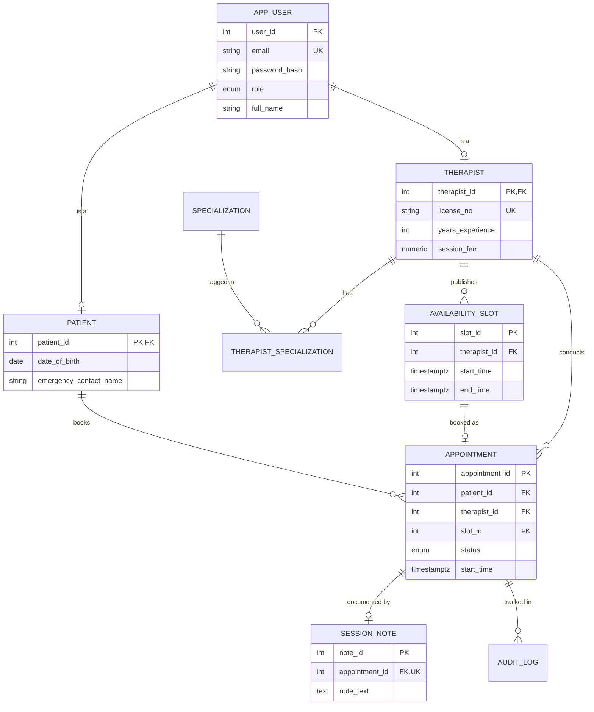

# Mental Health Appointment Portal

A relational database system (PostgreSQL + Python) for scheduling therapy sessions between **patients** and **therapists**, with **admin** oversight. Built as a Database Management Systems project, focused on data integrity, concurrency-safe booking, and role-based access control enforced inside the database.

## Features
- **ER model + normalized schema (3NF)** – users, patients, therapists, specializations (M:N), availability slots, appointments, confidential session notes, audit log
- **Data integrity via DDL** – PK/FK, `CHECK`, `UNIQUE`, enums, and `EXCLUDE` constraints that make double booking *impossible* (therapist, patient and slot level)
- **Concurrency-safe booking** – `book_appointment()` uses `SELECT … FOR UPDATE` row locking; a threaded test fires 12 simultaneous bookings at one slot → exactly 1 succeeds
- **Access control across 3 roles** – `GRANT`s + **Row Level Security**: patients see only their own data, therapists only their own appointments/notes, admins see everything
- **Business rules in the DB** – no past bookings, 24-hour cancellation policy, notes writable only by the assigned therapist
- **Session outcomes** – `complete_appointment()` lets only the assigned therapist mark a finished session completed/no-show and attach a note
- **Audit trail** – trigger logs every INSERT/UPDATE/DELETE on appointments (JSONB before/after)
- **Analytics (DML)** – 10 queries: joins, CTEs, window functions, anti-joins, `EXPLAIN ANALYZE`

## ER Diagram


## Tech stack
PostgreSQL 14+ (PL/pgSQL, `btree_gist`, `pgcrypto`) · Python 3 + psycopg2 · Git/GitHub

## Project structure
```
sql/01_schema.sql     DDL: types, tables, constraints, indexes
sql/02_logic.sql      booking/cancel functions, triggers, views
sql/03_security.sql   roles, GRANTs, Row Level Security
sql/04_seed.sql       demo data (DML)
sql/05_queries.sql    analytical queries
app/db.py, cli.py     Python data layer + interactive CLI
tests/test_integrity_rbac.sql  29 integrity / business-rule / access-control checks
tests/test_concurrency.py     race-condition proof (12 simultaneous bookings)
```

## Setup
```bash
createdb mhportal
./run_all.sh mhportal                 # builds schema + seed data
pip install -r requirements.txt
export DATABASE_URL="dbname=mhportal"
python -m app.cli                     # login: riya@mhportal.test / Password@123
./run_tests.sh mhportal               # 29 SQL checks + concurrency test (12 attempts -> 1 success)
```
Demo logins (password `Password@123`): `admin@mhportal.test`, `dr.sharma@mhportal.test`, `riya@mhportal.test`.

## Design decisions
| Decision | Why |
|---|---|
| Supertype `app_user` + subtype tables | Single login identity, role-specific attributes, no NULL-heavy table |
| `EXCLUDE USING gist` on time ranges | Overlap prevention enforced by the DB, not just app code |
| Row locking in `book_appointment` | Serialises concurrent bookings of the same slot |
| Partial unique index on active appointments | Cancelled slots can be rebooked while history is preserved |
| RLS instead of app-side filtering | Access control can't be bypassed by an app bug |
| Session notes in a separate table with no patient policy | Clinical notes stay confidential |

## Normalization
All tables are in 3NF: no repeating groups (specializations moved to a junction table), every non-key attribute depends only on its table's key (therapist fee on `therapist`, not `appointment`). `appointment.start/end_time` are deliberate controlled denormalization (validated against the slot by trigger) so overlap constraints can be enforced declaratively.

## Possible extensions
REST API (Flask/FastAPI), React frontend, email reminders, waitlist for booked slots.
